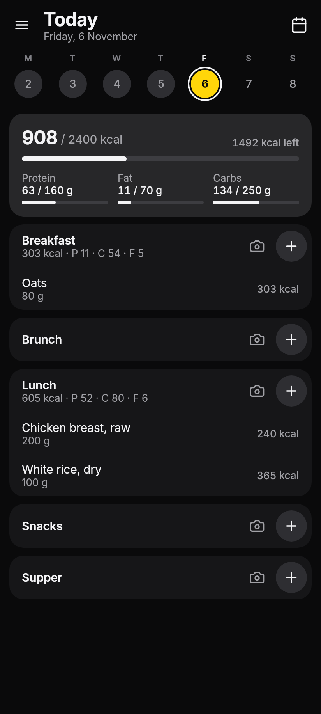
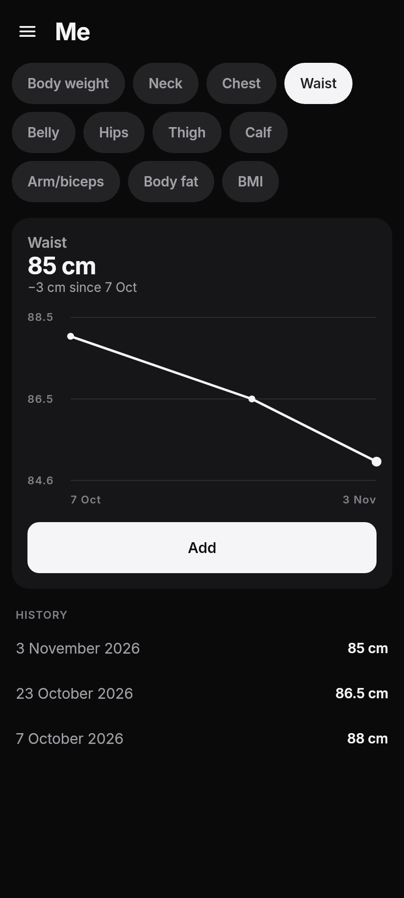

# GymPad

A gym log and food diary for Android that I made for myself and my friends. It works offline, you don't need an account, and it's in English and Polish.

| Workout | Variants | History |
|---|---|---|
|  |  |  |
| **Food** | **Me** | **Polski** |
|  |  |  |

## Download

Open this link on your phone to download the latest version:

**[GymPad.apk](https://github.com/Sji228/GymPad/releases/latest/download/GymPad.apk)**

Older versions are on the [releases page](https://github.com/Sji228/GymPad/releases). The first time you install, Android asks you to allow installing apps from your browser. Play Protect might also say it doesn't know the developer; tap "More details" and then "Install anyway". New versions install over the old one and keep your data. You need Android 8.0 or newer.

## What it does

### Workouts

Each set shows what you lifted last time in grey. If you're doing the same again, one tap on ✓ logs it, and the ±2.5 kg buttons next to the weight save you from opening the keyboard for small jumps.

An exercise can have variants, like barbell bench, dumbbell bench and the chest press machine. When the bench is taken you switch to another one right on the card, and each variant keeps its own history and PR. There are five routines you can rename and edit, a week strip at the top, and a calendar for the whole year: green is a finished workout, yellow a half-finished one.

### Food

Five meals a day with calories, protein, fat and carbs. If you set daily goals, the bars at the top fill up as you eat, and they stay there while you scroll.

You can scan a barcode or search by name. Around 35,000 products sold in Poland and about 90 basic foods (chicken, rice, eggs, fruit and so on) are built into the app, so it works without internet. If a product is missing, you type it in from the label once and the barcode is remembered. When adding food you see the last 100 things you ate, with the amount from last time. Any day can be edited, so you can add yesterday's dinner or plan tomorrow.

### Meal photos

The camera button next to a meal sends a photo, plus an optional note like "fried in olive oil", to Google's Gemini. It guesses the foods, their weight, calories and macros, then you check the list, fix anything that's off and add it to the meal. This needs your own Gemini API key, which is free from Google AI Studio. The app shows you how to get one the first time you tap the camera.

### Me

Body weight, neck, chest, waist, belly, hips, thigh, calf, arm, body fat and BMI, each with its own chart. BMI is worked out from your weight and height, so you only enter your height once.

## Privacy

Everything is stored on the phone and there's no server. The app asks for two permissions: the camera, for barcodes and meal photos, and the internet, which is only used to send meal photos to Gemini with your key. On Gemini's free tier, Google may use those photos to improve its products. Barcode scanning uses Google's ML Kit, which can send Google anonymous usage statistics.

Backup in the menu saves everything to a JSON file wherever you choose. The API key is never included.

## Building it yourself

It's written in Kotlin with Compose Multiplatform and Room. You need Java 17 or newer and the Android SDK (set `ANDROID_HOME`, or `sdk.dir` in `local.properties`). Gradle downloads JDK 21 for compiling by itself.

Run the app in a desktop window, reloading as you edit:

```bash
./gradlew :shared:hotRunJvm --auto --mainClass com.gympad.MainKt
```

Run the tests. They click through the real UI and save screenshots to `shared/build/screens/`:

```bash
./gradlew :shared:jvmTest
```

Build a debug APK, which doesn't need a signing key:

```bash
./gradlew :app:assembleDebug
```

For a signed release, put your keystore in `keystore/` together with a `keystore.properties` file (`storeFile`, `storePassword`, `keyAlias`, `keyPassword`), then run `./gradlew apk` and the APK ends up in `dist/`. Keep a copy of the keystore somewhere safe, because Android only installs updates signed with the same key.

The food catalog is generated by [`tools/catalog/build_catalog.py`](tools/catalog/build_catalog.py) from Open Food Facts and USDA data. How to run it is explained at the top of the script.

`app/` is just the Android entry point. Everything else is in `shared/`: the database, the logic, the screens and the text in both languages, plus a desktop window in `jvmMain` that I used for previewing.

## License

The code is under the [MIT license](LICENSE). The food catalog contains data from Open Food Facts and is under the [ODbL](https://opendatacommons.org/licenses/odbl/1-0/). Other credits are in [THIRD_PARTY_NOTICES.md](THIRD_PARTY_NOTICES.md).
