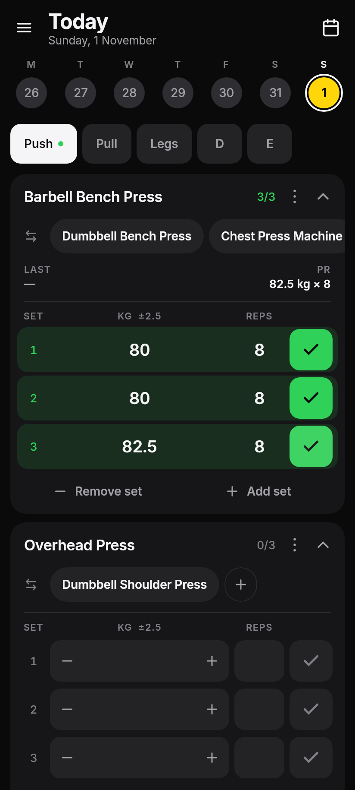
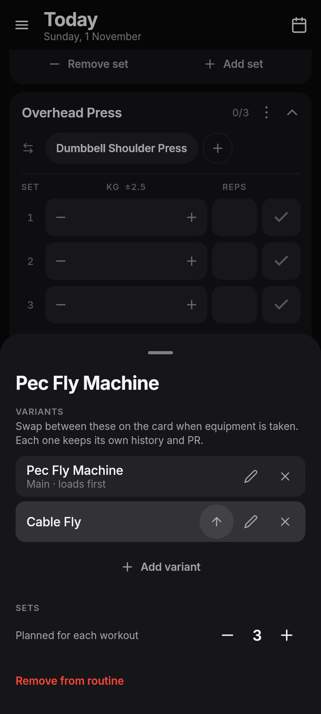
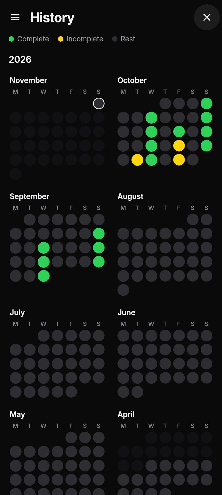
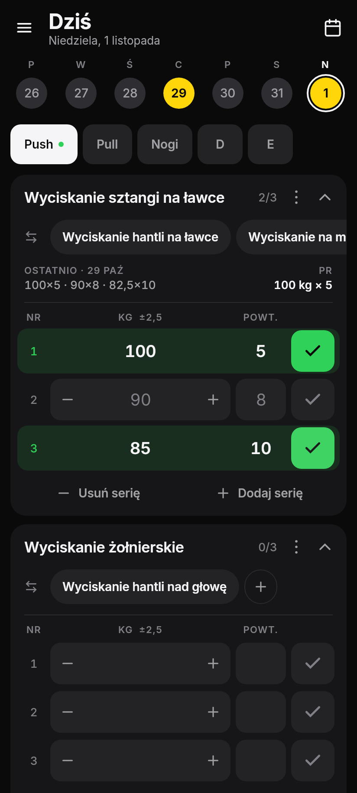

# GymPad

A minimalist, offline gym workout tracker for Android. No accounts, no cloud, no social feed: just your sets, fast enough to use with sweaty hands between them.

Available in English and Polish.

| Logging | Variants | History | Polski |
|---|---|---|---|
|  |  |  |  |

## Features

- **One-tap logging.** Each set shows what you lifted last time, by set number, as a gray ghost value, so straight sets and pyramids both work. If you repeat it, one tap on ✓ logs it.
- **±2.5 kg steppers** next to the weight, so small jumps don't need the keyboard.
- **Named variants.** Bench taken? Swap to the dumbbell or machine variant right on the card. Each variant keeps its own history and PR.
- **Last time and PR** on every card, so you can see at a glance how you compare.
- **Date ribbon and year history.** Green means complete, yellow means incomplete, gray means rest. Past days are read-only, so they can't be edited by accident.
- **Five nameable routines**, with exercises, variants and set counts you can edit.
- **JSON backup and restore** through the system file picker.

## Your data

Everything stays on your device. There is no server and no account.

Switching language never touches your training data. History, PRs and ghost values follow an exercise's internal ID rather than its name, so changing language writes nothing to the database:

- **Built-in exercises** are stored under one canonical name and translated only for display.
- **Names you type** are your own data and are never translated.
- **Typing a built-in's name in either language** reaches the same exercise, so one lift can't split into two histories.
- **Backups** are language-independent: export in one language, restore in the other.

## Building

You need Java 17 or newer to run Gradle, plus the Android SDK for Android builds. Point Gradle at the SDK with `ANDROID_HOME` or a `local.properties` file containing `sdk.dir=/path/to/sdk`. Gradle downloads the JDK 21 used for compiling on its own.

Preview the app in a desktop window, with changes reloading live:

```bash
./gradlew :shared:hotRunJvm --auto --mainClass com.gympad.MainKt
```

Run the tests. They drive the real UI against a real database, and write screenshots to `shared/build/screens/`:

```bash
./gradlew :shared:jvmTest
```

Build an installable debug APK, which needs no signing setup:

```bash
./gradlew :app:assembleDebug
```

### Release builds

Create a signing key. It isn't committed to the repository, so keep a backup: Android only installs updates signed with the same key.

```bash
mkdir -p keystore
keytool -genkeypair -keystore keystore/gympad-release.jks -alias gympad -keyalg RSA -keysize 4096 -validity 36500 -dname "CN=GymPad"
```

Then create `keystore/keystore.properties`:

```properties
storeFile=keystore/gympad-release.jks
storePassword=your-password
keyAlias=gympad
keyPassword=your-password
```

Build the signed APK into `dist/GymPad.apk`:

```bash
./gradlew apk
```

## Project layout

```
app/       Android entry point: Application, Activity, launcher icon
shared/
  src/commonMain/   Everything shared by Android and desktop
    data/           Room database, repository, backup format
    domain/         Pure logic: day status, ghost values, PRs, built-in names
    ui/             Compose screens, theme, icons
    ui/strings/     All UI text, one implementation per language
  src/androidMain/  Android file picker, back handling, database setup
  src/jvmMain/      Desktop window used for preview
  src/jvmTest/      Unit, migration and UI flow tests
  schemas/          Room schema history, needed for database migrations
```

Built with Kotlin, Compose Multiplatform, Room and kotlinx.serialization.

### Adding a language

Add an entry to `AppLanguage`, then implement `AppStrings` for it. Any text you miss is a compile error. Add translations of the built-in exercise names to `BuiltInNames`; the test suite fails if one is missing.

## License

[MIT](LICENSE). Bundled font and icon credits are in [THIRD_PARTY_NOTICES.md](THIRD_PARTY_NOTICES.md).
